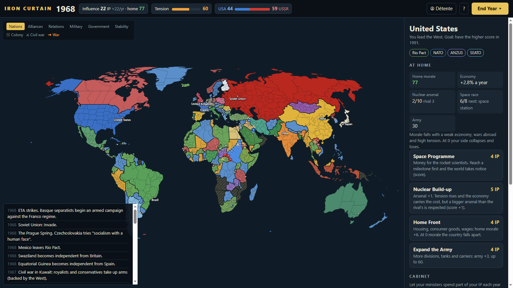

# Iron Curtain Lite

A small, free Cold War strategy game that runs in your browser. Lead the **United States**, the **Soviet Union** or any nation in between from 1947 to 1991, and come through the Cold War without starting a nuclear war. When the Cold War is judged at the end of 1991 you can keep playing into the new century.

### [▶ Play it in your browser](https://yelowwc.github.io/iron-curtain/)

## Play
**Online:** https://yelowwc.github.io/iron-curtain/

**Offline:** download or clone this repository and open `index.html` in any modern browser. No installation, no internet needed.

## How to play
- **Choose who you lead:** the **United States**, the **Soviet Union**, or any of the 75 or so nations that are independent in 1947.
- **Regions and unions:** the Soviet Union is made of its republics (Ukraine, the Baltic states, Georgia, Kazakhstan...), Yugoslavia and Czechoslovakia of theirs, and many countries hold regions that want more say: Scotland, Northern Ireland, Catalonia, the Basque Country, Quebec, Kurdistan, Eritrea, East Pakistan, Tibet... Regions can rise up and win their freedom, and unions can break apart (if the Soviet Union is weak at the end, it is dissolved and Russia remains).
- **Divided nations:** East and West Germany, North and South Vietnam, North and South Yemen and others can unite, through history or when both halves think alike.
- **Each year** you get Influence Points (IP). Click a country on the map and spend them, then press **End Year** (or Enter).
- **The map:** scroll to zoom and drag to move. Click a country to select all of it, including land it has annexed; double-click to select just one region and zoom onto it. Esc clears the selection.
- **As a superpower**, push countries past 60 toward you to bring them into your bloc. When 1991 ends, the bigger bloc wins. **Propaganda** (1 IP), **Economic Aid** (3 IP) and **Back a Coup** (5 IP) pull countries your way.
- **As a nation**, you get decisions of your own: Nehru's choice for India, the Suez Canal for Egypt, Nagy's choice for Hungary, Solidarity for Poland, the Bomb, the oil embargo, the debt crisis, joining the EU... Run your country: stabilise it, develop the economy, build the army, choose your foreign policy (West, East or non-aligned), join or leave alliances, make friends, and maybe invade a neighbour. If you are overthrown or conquered, the game is over.
- **Governments and parties:** every country has a government and five parties (Communists, Socialists, Liberals, Conservatives, Nationalists). Democracies hold elections; in dictatorships a strong opposition may rise up. Governments also change by themselves: kings fall, generals seize power, dictatorships return to democracy. Back a party with **+**, and in your own country hand power to a party with **⚑**.
- **Armies and wars:** every country has an army. **Invade** to attack. Take the enemy capital to weaken them. If the attacker wins, it installs a friendly government. Real wars happen too: the Arab–Israeli wars, India–Pakistan, Iran–Iraq, the Falklands...
- **War maps:** occupied land is drawn in the occupier's colour behind a solid front line. Each year the front rolls forward or back, arrows show where the offensives went, and both armies stand in facing lines along the front.
- **Peace:** in your own war, tick the terms you want (reparations, disarm them, a friendly government, annexation) and see if the enemy would sign. Win a war and you dictate the peace at a conference.
- **Borders change:** when a war ends in a truce, the ceasefire line becomes the new border. The loser may come back years later to win it back.
- **Occupied lands:** every country you annex and every piece of land you take is a territory with unrest and integration. Choose a policy (garrison, integrate, exploit, autonomy), invest, crack down, or release it. Too much unrest and it rises up; full integration makes it yours for good.
- **Form a nation:** unite with your neighbours into Germany, Korea, Gran Colombia, the Maghreb Union and more. Every member must be a close friend, defeated by you, or already yours. Annexed lands can rebel and break free.
- **Alliances:** NATO, the Warsaw Pact, SEATO, CENTO, ANZUS, the Rio Pact and later the European Union defend their members when they are attacked.
- **Civil wars** (⚔): arm a side or send troops. The rebels' territory is shown on the map.
- **Tension** rises with coups, invasions and crises. At 100 it is nuclear war and everyone loses. **Détente** (3 IP) lowers it.
- Real history happens along the way: over 110 historical events from 1947 to 2022 (the Berlin Blockade, the Cuban Missile Crisis, Vietnam, the fall of the Wall, the end of the Soviet Union, the wars in Yugoslavia, 9/11, the Arab Spring, Crimea...), but only when the world in your game still fits them. As a superpower you sometimes decide what to do.
- **After 1991:** the game tells you how you did in the Cold War, then you can play on as long as you like and press **End game** when you are done.
- **The map** shows capitals, and towns once you zoom in.
- **Saving:** the game saves itself in your browser after every move, so you can close the tab and carry on later.

## Files
- `game.js`: the rules (also runs in Node: `node tools/balance.js` plays computer against computer, `node tools/nation.js` plays some nations, `node tools/history.js` plays on to 2030 and counts how often history repeats itself)
- `data.js`: countries and regions (with hand-drawn shapes for lands the modern map lacks, like East Germany and South Vietnam), cities, alliances, divided nations and historical events
- `neighbours.js`: which countries border each other (made by `node tools/build-neighbours.js`)
- `ui.js`, `style.css`, `index.html`: the screen
- `tools/test.html`: opens a game and plays it automatically, e.g. `tools/test.html#US,10` (10 years as the USA) or `tools/test.html#US,20,EGY,still,v=45:26:2.6` (20 years, select Egypt, no animation, view centred on 45°E 26°N at zoom 2.6)
- `lib/`: d3, topojson-client and the world map (see Credits)

## Credits
- Map data: [Natural Earth](https://www.naturalearthdata.com/) (public domain) via [world-atlas](https://github.com/topojson/world-atlas) (ISC)
- [d3](https://d3js.org/) (ISC) and [topojson-client](https://github.com/topojson/topojson-client) (ISC)

## License
MIT. See `LICENSE`.
