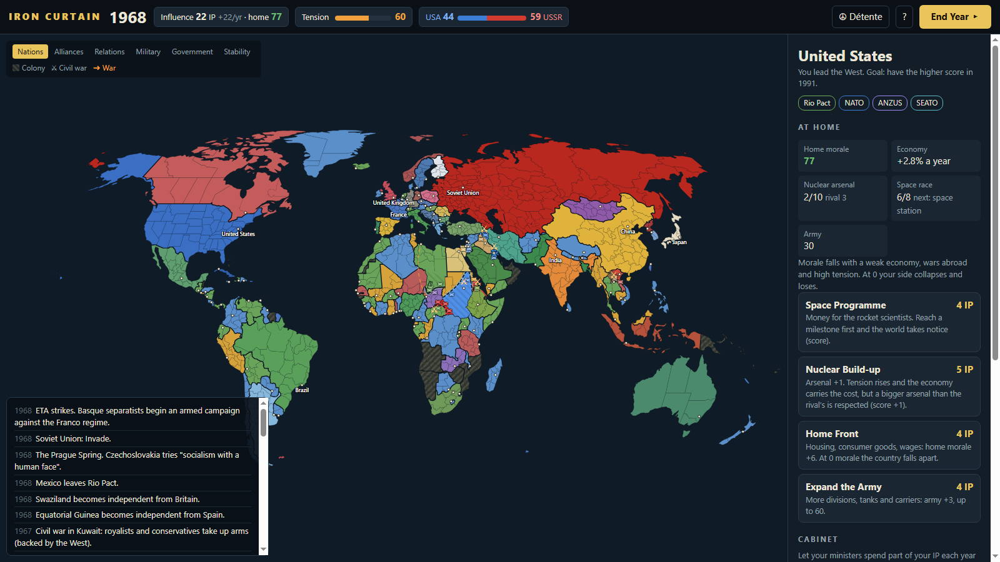

# Iron Curtain

A free Cold War strategy game that runs in your browser. Lead the **United States**, the **Soviet Union** or any nation in between from 1947 to 1991, and come through the Cold War without starting a nuclear war. When the Cold War is judged at the end of 1991 you can keep playing into the new century.

### [▶ Play it in your browser](https://yelowwc.github.io/iron-curtain/)

## Play
**Online:** https://yelowwc.github.io/iron-curtain/

**Offline:** download or clone this repository and open `index.html` in any modern browser. No installation, no internet needed.

## How to play
- **Choose who you lead:** the **United States**, the **Soviet Union**, any of the 75 or so nations that are independent in 1947, or a nation still **inside a union** (Ukraine, the Baltic states, Scotland, Catalonia, Quebec...): build a national movement, arm a secret militia and choose the moment to declare independence. Rise too early and the centre crushes you.
- **Regions and unions:** the Soviet Union is made of its republics (Ukraine, the Baltic states, Georgia, Kazakhstan...), Yugoslavia and Czechoslovakia of theirs, and many countries hold regions that want more say: Scotland, Northern Ireland, Catalonia, the Basque Country, Quebec, Kurdistan, Eritrea, East Pakistan, Tibet... Regions can rise up and win their freedom, and unions can break apart (if the Soviet Union is weak at the end, it is dissolved and Russia remains).
- **Divided nations:** East and West Germany, North and South Vietnam, North and South Yemen and others can unite, through history or when both halves think alike.
- **Each year** you get Influence Points (IP). Click a country on the map and spend them, then press **End Season** (or Enter). The year runs in four seasons (Spring, Summer, Autumn, Winter); new IP comes each spring.
- **The map:** scroll to zoom and drag to move. Click a country to select all of it, including land it has annexed; double-click to select just one region and zoom onto it. Esc clears the selection.
- **As a superpower**, push countries past 60 toward you to bring them into your bloc. When 1991 ends, the bigger bloc wins. **Propaganda** (1 IP), **Economic Aid** (3 IP) and **Back a Coup** (5 IP) pull countries your way.
- **At home** (superpowers): the **space race** (be first to the satellite, man in orbit, the Moon...), the **arms race**, **home morale** and the **economy**. Soviet growth slows over the decades; wars abroad and a weak economy wear morale down, and at 0 your side collapses. Programmes: Space Programme, Nuclear Build-up, Home Front, Expand the Army.
- **Cabinet:** let your ministers spend part of your IP each year (choose how much and what to focus on).
- **As a nation**, you get decisions of your own: Nehru's choice for India, the Suez Canal for Egypt, Nagy's choice for Hungary, Solidarity for Poland, the Bomb, the oil embargo, the debt crisis, joining the EU... Run your country: stabilise it, develop the economy, build the army, choose your foreign policy (West, East or non-aligned), join or leave alliances, make friends, and maybe invade a neighbour. If you are overthrown or conquered, the game is over.
- **Governments and parties:** every country has a government and five parties (Communists, Socialists, Liberals, Conservatives, Nationalists). Democracies hold elections; in dictatorships a strong opposition may rise up. Governments also change by themselves: kings fall, generals seize power, dictatorships return to democracy. Back a party with **+**, and in your own country hand power to a party with **⚑**.
- **Armies and wars:** every country has an army, and in a war it becomes **divisions** that move freely over the map, like in Hearts of Iron. The world is cut into half-degree cells (about 50 km, `provgrid.js`); a division marches cell by cell toward any point you send it to, and the ground goes to whichever side's division is clearly closer, so the front runs about halfway between the armies and moves only where divisions move or win. A division walks its route on the map while the front rolls to its new place, and stops on the exact spot you sent it to. The year always runs **season by season** (Spring, Summer, Autumn, Winter). Every division is its own square (yours have a gold rim): click one, shift-click to add more, double-click for all of yours in a province, or **shift + drag a box**; then **drag an arrow** from them to where they shall go (or right-click a spot). A division covers about 320 km a season through its own land, half that while taking enemy ground, and less in winter. Divisions that come into contact fight: strength, readiness, the defender's advantage, attacks from several sides and allies count; a defended spot holds until its defenders are worn out, then they fall back, and a division with nowhere to go is destroyed. **Encirclement:** supply runs cell by cell from a side's capital (and its own coasts); close a ring around enemy divisions and they waste away and surrender, and enemy land inside the ring with nobody in it falls to you. Behind the divisions you see, each side has **front-line troops** spread along the whole front (about a quarter of its army again): they are not on the map and take no orders, and only in the gaps where no division stands they push the line wherever their side is stronger and hold it where it is weaker, wear down in the fighting and fill up each season. Leave divisions on **front orders** and your generals spread them along the whole front, one post each (a second line behind a short front), and send only a quarter of them in strike groups of two or three at the enemy's weak spots and at bulges they can cut off (**Advance** or **Hold the line**). The computer fights every other war the same way. A country falls when it loses its capital and most of its land (or its whole army). **War exhaustion** (0-100 per side, in the war panel) grows every season, faster the longer the war lasts, with every division lost, the land the enemy holds and a fallen capital, slower for a side winning ground; shaky states tire sooner, rebels and superpowers later. A tired army attacks less and recovers slower, at 80 there are protests and desertions, and at 100 the side must make peace: if it has lost land it loses the war, otherwise the war just stops (a truce freezes the front line). A tired enemy also accepts harsher terms at the negotiating table, and a province counts as taken when most of it is held. Real wars happen too: the Arab–Israeli wars, India–Pakistan, Iran–Iraq, the Falklands...
- **War maps:** occupied land takes the occupier's colour with hatching, a dark front line with the attacker's colour inside it runs through the land, ⚔ badges mark last season's battles, and your marching orders show as dashed gold lines.
- **Peace:** during your own war you can tick terms and offer them (see whether they would sign). A war won outright ends in a **peace conference** like in Hearts of Iron: every winner gets points for its part in the war, and turn by turn, most points first, each makes one demand: click provinces on the map to take them (the province borders show while the conference sits), or puppet the loser, install a new government, free one of its regions, take reparations or disarm it. Land must touch what you hold or have claimed (land your army occupies can always be claimed, and costs less), the loser is never cut in two, and there is no annex button: take a country province by province, the capital last, and taking the capital annexes it.
- **Provinces:** the world is split into about 900 real provinces. When land changes hands (a truce, a peace treaty, a clear win next door) it goes as one compact block of border provinces: never the capital, never cutting the loser in two, at most a third of it. The loser may come back years later to win it back.
- **Peace offers:** in your own war the other side writes to you: concessions when it is losing, demands when it is winning.
- **Occupied lands:** every country you annex and every piece of land you take is a territory with unrest and integration. Choose a policy (garrison, integrate, exploit, autonomy), invest, crack down, or release it. Too much unrest and it rises up; full integration makes it yours for good.
- **Form a nation:** unite with your neighbours into Germany, Korea, Gran Colombia, the Maghreb Union and more. Every member must be a close friend, defeated by you, or already yours. Annexed lands can rebel and break free.
- **Decisions** (like national focuses, but decisions; open the 📜 Decisions window from your panel): every country has a tree of 26 in four branches - Economy (Five-Year Plan or Open Markets, Heavy Industry, Roads and Railways, Light Industry, Economic Miracle), Army (Conscription, Officer Academy, Fortifications, Modern Equipment, Arms Industry), Politics (Strengthen the State, then Secret Police and a Party Purge or Reforms and Free Elections, National Unity) and Foreign policy (West, East or Non-Aligned, then an alliance or the Third World, Military Aid or Peacemaker, Regional Power). Fourteen countries have a branch of their own: China, India, Egypt, Yugoslavia, West Germany, France, Britain, Japan, Israel, Cuba, North Vietnam, Iran, Poland and Brazil (Great Leap Forward, Smiling Buddha, Suez, Tito's own road, Wirtschaftswunder, Force de Frappe, the Commonwealth, the Japanese Miracle, Dimona, the Revolution, the Ho Chi Minh Trail, the White Revolution, the Polish Road, Brasília...). The superpowers have nine and eight (Truman Doctrine, Marshall Plan, Containment, NASA, Peace Corps, Alliance for Progress, Great Society, Détente, SDI; Cominform, Bloc Discipline, The Thaw, Rocket Programme, Virgin Lands, Wars of Liberation, Brezhnev Doctrine, Perestroika). Each costs IP and needs the ones above it; some close others for good. The computer countries walk their trees too, and a country's panel shows the path it took.
- **Going their own way:** nationalists, kings, dictators and juntas may lean toward a superpower, but they do not join its bloc unless they sign up to an alliance (NATO, CENTO, SEATO...), and propaganda and aid move them less. Nationalist officers and royalists who win a civil war only lean toward their patron.
- **Alliances:** NATO, the Warsaw Pact, SEATO, CENTO, ANZUS, the Rio Pact and later the European Union defend their members when they are attacked.
- **Civil wars** (⚔): rebels fight for a cause (communists, socialist revolutionaries, democrats, royalists, nationalist officers) and build their own kind of state if they win. They are fought with divisions too: the rebels rise far from the capital (or next to a friendly neighbour), hold provinces in their cause's colour and win by taking the capital and half the land (a region fighting for independence: 60% of it); the government wins by destroying their army, and after 10 years there is a truce. Arm a side or send troops (your divisions join in). In your own civil war you command the loyal divisions; in your own rising inside a union you command the rebels. Countries of a single province still fight the old way, on a bar.
- **Tension** rises with coups, invasions and crises. At 100 it is nuclear war and everyone loses. **Détente** (3 IP) lowers it.
- Real history happens along the way: over 110 historical events from 1947 to 2022 (the Berlin Blockade, the Cuban Missile Crisis, Vietnam, the fall of the Wall, the end of the Soviet Union, the wars in Yugoslavia, 9/11, the Arab Spring, Crimea...), but only when the world in your game still fits them. As a superpower you sometimes decide what to do.
- **After 1991:** the game tells you how you did in the Cold War, then you can play on as long as you like and press **End game** when you are done.
- **The map** shows capitals, and towns once you zoom in. **Map modes** (keys 1-6, or M): Nations, Alliances, Relations, Military, Government, Stability.
- **Saving:** the game saves itself in your browser after every move, so you can close the tab and carry on later.

## Files
- `game.js`: the rules (also runs in Node: `node tools/balance.js` plays computer against computer, `node tools/nation.js` plays some nations, `node tools/history.js` plays on to 2030 and counts how often history repeats itself)
- `data.js`: countries and regions (with hand-drawn shapes for lands the modern map lacks, like East Germany and South Vietnam), cities, alliances, divided nations and historical events
- `neighbours.js`: which countries border each other (made by `node tools/build-neighbours.js`)
- `provinces.js`, `lib/provinces.js`: the provinces (names, neighbours, shapes), made by `sh tools/build_provinces.sh` from Natural Earth admin-1 data (needs Python with shapely, and `npm install topojson-server topojson-simplify topojson-client` in `tools/`)
- `ui.js`, `style.css`, `index.html`: the screen
- `tools/clicktest.html`: clicks through the real game screen like a player (start screen, your nation, regions, an uprising, saving, a peace conference, a decision, the 1991 verdict, End game) and prints a pass/fail report
- `tools/test.html`: opens a game and plays it automatically, e.g. `tools/test.html#US,10` (10 years as the USA) or `tools/test.html#US,20,EGY,still,v=45:26:2.6` (20 years, select Egypt, no animation, view centred on 45°E 26°N at zoom 2.6)
- `lib/`: d3, topojson-client and the world map (see Credits)

## Credits
- Map data: [Natural Earth](https://www.naturalearthdata.com/) (public domain): countries via [world-atlas](https://github.com/topojson/world-atlas) (ISC), provinces from the 1:10m admin-1 states and provinces
- [d3](https://d3js.org/) (ISC) and [topojson-client](https://github.com/topojson/topojson-client) (ISC)

## License
MIT. See `LICENSE`.
